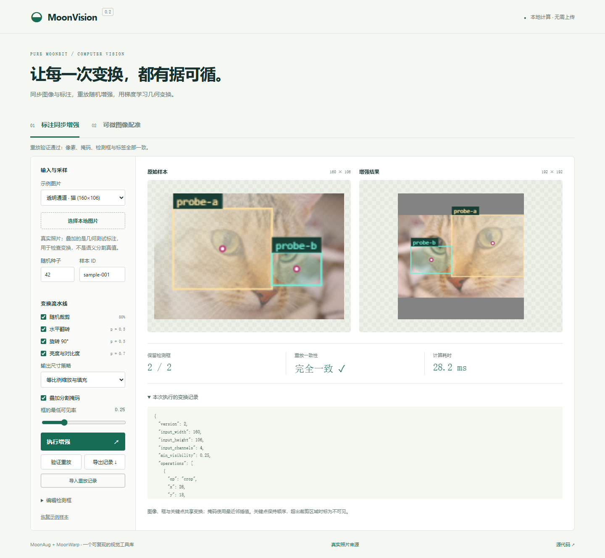
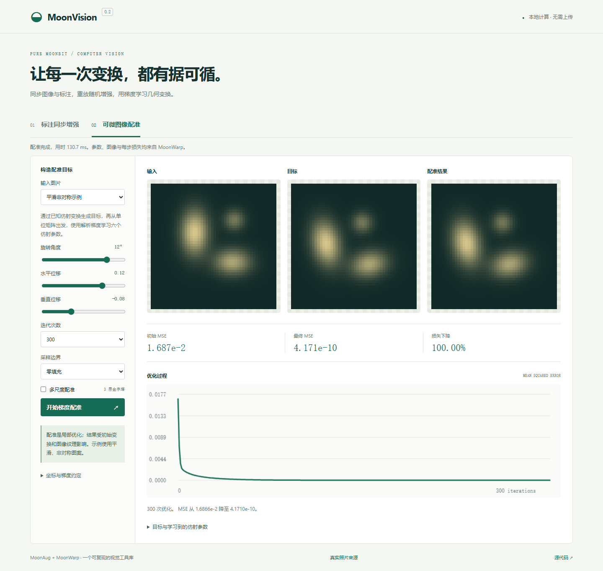

# MoonVision

[](https://github.com/buildliming/moonvision/actions/workflows/ci.yml)

纯 MoonBit 计算机视觉工具库：**可复现的标注同步增强 + 可微图像几何变换**。

MoonVision 把视觉数据处理与模型中的空间采样放在一个有明确数值约定的项目中。核心算法不调用 Python、C/C++ 或外部推理引擎；Python/PyTorch 只用于生成独立测试参考。两个包可以分别导入。

| 包 | 用途 | 已实现 |
| --- | --- | --- |
| [`moonaug`](moonaug/README.md) | 检测、分割数据增强 | 图像/mask/bbox 同步，裁剪、缩放、翻转、90°旋转、亮度/对比度，概率管线，按 seed/sample ID 确定采样，版本化 JSON replay |
| [`moonwarp`](moonwarp/README.md) | 可微采样与图像配准 | NCHW 张量、仿射网格、双线性零填充采样、输入/grid/theta 解析梯度、六参数仿射配准、两种 align_corners |
| [`interop`](interop/README.md) | 连接两个核心模块 | HWC 字节图像与归一化 NCHW 张量转换、灰度/RGB/RGBA、多 batch 选择 |

## 快速运行

安装 [MoonBit 工具链](https://www.moonbitlang.com/download/)。本项目验证环境为 `moon 0.1.20260920`、`moonc v0.10.14+7d59c7ec9`，使用新版 `moon.mod` / `moon.pkg` 配置。

```text
git clone --branch default https://github.com/buildliming/moonvision.git
cd moonvision
moon check --target all --deny-warn
moon test
moon run examples/main
moon run examples/pipeline
```

正常构建和 MoonBit 测试无需 Python、NumPy 或 PyTorch，也没有第三方 Mooncakes 依赖。

### 浏览器演示

需要 Python 3 和 Node.js；无须 npm 安装依赖。

```text
python tools/build_web.py
python tools/serve_demo.py
```

打开 `http://127.0.0.1:8765`。图片只在本机浏览器处理，计算在 Web Worker 中运行。

- **标注同步增强**：运行内置带标注样本、编辑检测框、上传本地图片、改变随机种子、导入/导出重放记录，验证像素和标注的精确重放。
- **可微图像配准**：改变旋转和平移，观察从单位矩阵开始学习六个仿射参数、损失曲线和配准结果。





### 作为 MoonBit 库使用

仓库尚未发布到 Mooncakes；不要把 `moon add buildliming/moonvision` 当作目前可用的安装命令。在本仓库内的 `moon.pkg` 导入所需包即可：

```moonbit
import {
  "buildliming/moonvision/moonaug",
  "buildliming/moonvision/moonwarp",
}
```

具体 typed API、错误处理和示例见 [MoonAug 文档](moonaug/README.md)、[MoonWarp 文档](moonwarp/README.md)，完整公共接口由各包的 `pkg.generated.mbti` 记录。

### JSON / Node.js 接口

```text
node tools/moonvision.mjs augment examples/requests/augment.json
node tools/moonvision.mjs warp examples/requests/warp.json
node tools/test_bridge.mjs
```

不带文件名时，CLI 逐行读取标准输入的 JSON 请求并逐行返回结果。请求错误返回 `{"ok":false,"error":"..."}`。浏览器与 Node 使用相同的 MoonBit 编译产物。

## 正确性与复现

- **60 个 MoonBit 测试**在 `wasm-gc`、`wasm`、`js`、`native` 后端验证；每个后端单独执行。
- 独立 CPU PyTorch float64 参考覆盖采样前向、输入/grid/theta 梯度、多 batch/channel、非方形与单像素维度、边界和两种角点约定。
- 中央有限差分校验平滑位置的梯度；不可微边界单独对照 PyTorch 的取值约定。
- NumPy/PyTorch 图像参考覆盖增强结果、框几何、整数 mask、alpha 保留、组合变换和重放。
- Node.js 桥接的 **29 项端到端检查**验证 JSON 传输、参考数值、错误输入和重放。当前参考下采样与梯度最大绝对误差为 `8.881784197001252e-16`；不代表所有输入的误差上限。

```text
python tools/verify.py
```

重新生成参考才需要 Python 的数值依赖：

```text
python -m pip install -r verification/requirements.txt
python verification/generate_references.py --check
```

详见 [复现说明](docs/reproduction.md)、[独立参考说明](verification/README.md) 和 [验收记录](docs/validation.md)。

## 支持边界

MoonAug 处理已解码的灰度/RGB/RGBA 像素和非负整数类别 mask，框使用连续半开区间 xyxy。颜色变换保留 alpha；缩放不执行抗锯齿、线性光转换或预乘 alpha。重放记录保存已解析参数和输入尺寸，不保存源图像身份。

MoonWarp 首版支持二维、双线性、零填充和一阶梯度。配准是局部优化，依赖纹理及初始位置；不保证任意图像都能对齐。张量、请求文本和操作数量都有明确上限，详见包文档。

本版本不包含通用训练框架、GPU、任意透视增强、关键点增强或图像编解码器。浏览器上传图片使用浏览器解码能力；MoonBit 核心接收像素数组。

## 项目结构

```text
moonaug/       标注同步增强、确定性采样、replay、JSON 边界
moonwarp/      张量、采样、解析梯度、配准、JSON 边界
bridge/        两个包的 JavaScript 导出
examples/      MoonBit 可运行示例和 JSON 请求
verification/  独立参考数据、生成器、固定依赖
web/           本地浏览器实验室
tools/         构建、验证、命令行、演示服务器
docs/          数值设计、复现、验收、参赛说明
```

## License / References

沿用仓库原有 [MIT 许可证](LICENSE)。实现参考公开语义与论文，测试调用第三方工具作为独立数值基准；第三方工具不随核心库打包。

- [PyTorch grid_sample](https://docs.pytorch.org/docs/stable/generated/torch.nn.functional.grid_sample.html)
- [PyTorch affine_grid](https://docs.pytorch.org/docs/stable/generated/torch.nn.functional.affine_grid.html)
- [Spatial Transformer Networks](https://arxiv.org/abs/1506.02025)
- [Albumentations additional targets](https://albumentations.ai/docs/4-advanced-guides/additional-targets/)

开发使用 AI 辅助代码、测试和文档，功能与验收结果以本仓库可运行代码和复现命令为准。参赛摘要见 [docs/hackathon.md](docs/hackathon.md)。
