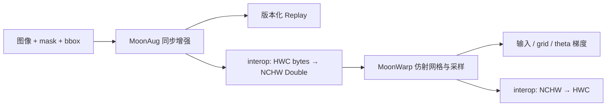

# 数值设计与模块边界

## 一个项目，两种空间变换需求

MoonAug 关注离散数据与标注的一致性，MoonWarp 关注连续采样对图像和坐标的梯度。两包独立可用；`interop` 提供字节图像与归一化 NCHW 张量的转换。

## MoonAug

输入像素按 HWC 紧密排列，类别 mask 按 HW 排列，框使用连续半开区间 xyxy。每个随机步骤只采样一次；图像、mask、框共用解析后的变换。种子和 sample ID 决定私有随机流，和调用顺序、系统时间及全局随机状态无关。

每个裁剪对框做交集、平移和可见率判断；类别标签属于框结构，因此不会与过滤后的框错位。mask 使用像素中心最近邻；图像缩放使用半像素双线性与边界夹取。颜色操作只改变灰度/RGB，RGBA 的 alpha 保留。

Replay v1 保存原始形状、可见率策略和已应用的确定参数，随机裁剪解析为普通裁剪。重放不再次抽样。它验证输入形状，但允许用于同形状的另一张图；数据集身份由调用者管理。

## MoonWarp

输入为 NCHW Double，grid 为 NHW2，最后一维的顺序是 x、y。`theta` 是每个 batch 的输出坐标到输入坐标的 2×3 逆向采样矩阵。

归一化坐标 g 映射到像素坐标 p：

- `align_corners=false`：`p = ((g + 1) * size - 1) / 2`。
- `align_corners=true`：`p = (g + 1) * (size - 1) / 2`。

双线性采样组合四个相邻像素。图像外的像素贡献为零。反向计算向四个像素累加输入梯度，再乘归一化坐标的缩放因子得到 grid 梯度；仿射网格反传将坐标梯度累加到六个矩阵系数。

整数像素边界处导数并不唯一。实现按照 PyTorch CPU 的 floor 选区约定对照，有限差分只用于远离不光滑点的位置。极远但有限的坐标在转换为整数索引前被排除。

六参数配准以 MSE 为目标，使用解析梯度和最多 16 次回溯。只接受使损失下降的参数更新；最后返回的图像、theta 与末项 loss 对应。它是局部方法，不把大位移、无纹理或不相关图像的配准成功作为承诺。

## 两种 resize 不能直接混同

MoonAug resize 的边界是 clamp；MoonWarp 的边界是 zero。即使都使用半像素坐标，边缘处也可能不同。MoonAug 还会量化回 uint8，MoonWarp 保持 Double，不能把两者逐像素完全相等作为一般性质。

## 错误与所有权

typed API 使用可捕获的错误；JSON 边界将错误转成 `ok:false`，不让非法输入逃逸为未捕获异常。所有形状乘法在分配前检查。操作不修改调用方输入；Warp 的构造和访问函数使用防御性副本。资源上限见各包 README，跨模块转换按更小的 Warp 上限检查。

## 参考依据

语义参考 [PyTorch grid_sample](https://docs.pytorch.org/docs/stable/generated/torch.nn.functional.grid_sample.html)、[affine_grid](https://docs.pytorch.org/docs/stable/generated/torch.nn.functional.affine_grid.html) 与 [Spatial Transformer Networks](https://arxiv.org/abs/1506.02025)。增强需求参考 [Albumentations 多目标变换](https://albumentations.ai/docs/4-advanced-guides/additional-targets/)。这些工具用于定义语义和生成测试参考，不作为核心运行时依赖。
