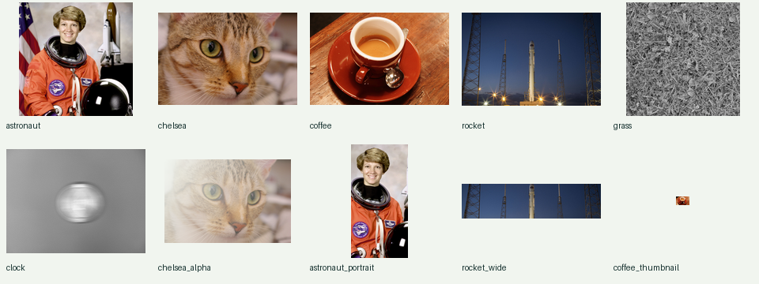

# 真实图片测试

仓库包含 **6 张原照片、10 组离线样本**。每个 PNG、原始来源文件和解码像素都记录 SHA-256，测试不联网下载。

要直接复用文件到模型输入的完整流程，可运行 `python examples/real_pipeline.py`。该案例只需要 Pillow、Node 和已构建的 MoonBit bridge，输出来源记录、Replay、归一化 NCHW 张量和对照拼图；不需要 PyTorch/NumPy。参见 [案例与改进分析](improvement-review.md)。



## 图片种类与来源

| 样本 | 内容 | 数据形态 |
| --- | --- | --- |
| astronaut | NASA 人物照片 | 192×192 RGB |
| chelsea | 猫与毛发纹理 | 224×149 RGB |
| coffee | 咖啡杯、瓷器、木纹 | 240×160 RGB |
| rocket | 室外发射场与暗天空 | 256×171 RGB |
| grass | 自然草地纹理 | 192×192 灰度 |
| clock | 运动模糊时钟 | 224×168 灰度 |
| chelsea_alpha | 猫照片的透明通道派生样本 | 160×106 RGBA |
| astronaut_portrait | 人物照片竖幅裁剪 | 96×192 RGB |
| rocket_wide | 室外照片宽幅裁剪 | 256×64 RGB |
| coffee_thumbnail | 极小真实照片缩略图 | 17×11 RGB |

照片由 scikit-image 数据集维护者明确标为 public domain / CC0。作者、原始链接、许可证据和派生步骤见 [逐图归属](../web/samples/ATTRIBUTION.md) 与 [机器可读清单](../web/samples/manifest.json)。透明 alpha 是明确生成的测试渐变，并非原照片的真实抠图。

框、mask 和关键点是叠加在真实像素上的**几何验证探针**，用于检查坐标与像素同步；它们不是人工语义标注，不用于宣称目标检测准确率或分割精度。

## 大图编译产物对照

```text
python -m pip install -r verification/requirements.txt
python tools/build_web.py
python verification/test_real_images.py
```

此脚本以持久 Node 子进程调用真正的 MoonBit 编译产物，完成 **173 次 JSON 接口检查**：

- 每图三条增强流水线，包括基础几何与颜色、Letterbox、RandomResizedCrop。
- NumPy/PyTorch 独立计算像素、mask、bbox 和关键点期望值。mask 必须精确相等，resize/颜色允许一个 uint8 灰阶差。
- 每条流水线检查序列化重放，随机裁剪再次执行检查确定性。
- bilinear/zeros、bilinear/border、bilinear/reflection、nearest/zeros 的真实像素对照。
- 对输入和 theta 的解析梯度对照，以及有明确距离像素节点余量的中央有限差分。
- 整张图片与框、mask、关键点联合仿射变换。
- 双图 batch 的归一化和反归一化，要求字节往返一致。
- 人物、动物和模糊图片的多尺度局部配准，核对返回参数、输出与损失。

实际结果写入 `artifacts/real-images-report.json`，含逐图误差、有限差分余量、配准损失与依赖版本；同时生成 `artifacts/real-images-results.png`。本次验收快照见 [结果 JSON](real-images-results.json)。

[查看真实图变换对照图](images/real-results.png)。

## 最近邻与梯度的非光滑边界

独立 affine_grid 的 1ulp 误差可能跨过半像素最近邻边界，或双线性导数的整数像素节点。因此：

- 采样器在**相同输入 grid**上严格对拍；nearest 像素误差要求为零。
- 两个独立 grid 本身按 `1e-14` 对照，theta 路径远离最近邻节点的像素仍要求精确一致。
- 梯度在相同 grid 上通过 PyTorch autograd 和 affine-grid Jacobian 独立对照。
- 仿射链有限差分使用确定性的小扰动，先确认所有坐标离节点至少 `1e-5` 像素，再以 `1e-8` 差分。报告实际余量。
- 扩展合成参考中的刻意边界用例使用二进制可精确表示的坐标与尺寸，并校验分步、重结合和融合运算得到相同像素位置；一般尺寸的平滑用例有独立节点间距审计。

这保持了不连续位置的真实语义，测试不会把离散像素差直接解释为普通连续误差。

## 四后端真实像素回归

```text
python verification/generate_real_image_references.py --check-numerical
moon test moonwarp --target wasm-gc
moon test moonwarp --target wasm
moon test moonwarp --target js
moon test moonwarp --target native
```

每张图另外生成一组 10×8 的真实像素参考，嵌入 MoonBit 黑盒测试，覆盖反射双线性前向、输入/theta 梯度、nearest/border 与精确类别选择。这些测试直接随四个后端运行，不依赖 MoonBit 图像解码器、Python 或网络。

本次完整真实图验收：增强字节误差最多 1；连续采样最大绝对误差约 `5.56e-14`；梯度最大绝对误差约 `4.1e-16`。这些是所列图片与参数的实测，不能外推为全部输入的统一界限。

## 退化图像与复杂边界回归

```text
python tools/build_web.py
python verification/test_stress_images.py
```

此回归复用现有真实图的持久 Node 桥接与独立标注核对函数，不增加运行时依赖。每张离线样本先核验文件和解码像素 SHA-256，再缩到 23×17，确定性地产生十种输入：高斯模糊、圆盘失焦、对角运动模糊、低对比、固定种子传感器噪声、常量颜色、矩形遮挡、单行、单列、单像素。RGBA 的颜色退化保留原 alpha。原始模糊时钟照片也参与派生，共 100 组。

- 以相同显式 grid 对照 CPU PyTorch float64，覆盖 bilinear/nearest × zeros/border/reflection × 两种角点模式；前向、输入梯度与 grid 梯度都核对，多 batch 内容不同，避免批次步长错误被相同数据掩盖。nearest 要求精确一致。坐标与填充语义依据 [PyTorch grid_sample](https://docs.pytorch.org/docs/2.12/generated/torch.nn.functional.grid_sample.html)。
- 组合 49×49 resize、随机缩放裁剪、Pad、负向四分之一旋转和概率翻转，核对框、关键点、mask 与图像，重复调用与序列化 replay 必须一致。mask 包含相邻的 `2147483646`/`2147483647`，填充值也使用最大 int32。
- 逐通道均值与标准差不同，核对双图 batch 的独立归一化数值及精确字节往返；单位仿射保持标注和类别不变。标注路径对 `align_corners=true` 单像素轴返回结构化错误。
- 对三种模糊、低对比、常量及单像素轴输入运行单尺度/多尺度配准。独立重采样返回 theta，核验输出、初末 MSE 和每层损失单调性。平坦或模糊图可能无法唯一确定几何关系，因此不以恢复指定 theta 为通过条件。
- 在三种 JSON 接口中注入 null、错误类型和损坏嵌套结构，错误后紧接有效请求，要求同一进程继续返回原有正确结果。

结果写入 `artifacts/stress-images-report.json`，包含每例输入像素哈希、误差、配准初末损失和依赖版本。`python tools/verify.py --real-images` 和 CI 均执行此脚本。测试验证图像处理和数值约定，不衡量识别准确率，也不保证所有模糊图像的配准成功。
